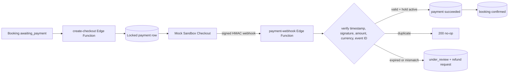

# Phase 3 sandbox payments

## Flow



The browser only starts checkout and polls status. It never changes a payment or booking to succeeded/confirmed. The `payment-webhook` function reads the exact request body, rejects missing/invalid/stale HMAC signatures, and passes only verified, normalized event data to the locked database RPC.

## Payment state machine

```text
created -> pending -> succeeded -> refunded
created -> pending -> failed -> pending (retry while hold is valid)
created -> pending -> cancelled -> pending (retry while hold is valid)
created/pending -> expired
succeeded -> partially_refunded -> refunded
any provider result with amount/currency mismatch -> under_review
succeeded after booking hold expiry -> under_review + refund requested; booking stays expired
```

The active payment index prevents duplicate pending/succeeded payments for one service. The deterministic key `ride-booking:<booking-id>` makes repeated `create-checkout` calls idempotent. Provider event IDs are unique in the append-only transaction ledger, so duplicate and concurrent webhook deliveries do not reprocess fulfillment.

## Amounts and settlements

All amounts use PostgreSQL `numeric(12,2)` and the frontend tests use integer minor-unit calculations. For a PKR 400 fare with a 10% commission: gross = 400, commission = 40, provider net = 360. The commission rate/fixed amount is snapshotted onto each payment. A settlement is created as `eligible` only after the ride booking reaches `completed`; an admin can mark it paid with a manual reference, which writes an audit log and does not send a payout.

## Refunds and cancellation

Driver cancellation of a paid confirmed booking creates a refund request. Passenger cancellation creates a refund request using the disclosed cancellation-policy path; policy-specific amount decisions remain server-side and must be finalized before production. Refund RPCs lock the payment and sum prior requested/processed refunds so an over-refund fails. The Mock provider marks the provider action processed and notifications explain that no real money moved.

## Provider adapters

`PaymentProvider` defines `createCheckout`, `verifyWebhook`, `parseWebhookEvent`, `getPaymentStatus` and `refund`. `MockSandboxProvider` is the only tested development provider and clearly labels every surface `SANDBOX — NO REAL MONEY`. Safepay is an explicit untested skeleton that refuses to guess undocumented API behavior. JazzCash and Easypaisa are extension points only.

To add a provider: implement the interface in the Edge shared adapter, use its exact documented signature/amount/currency rules, normalize events into the internal schema, add provider-specific secrets through Supabase Edge secrets, add duplicate/replay/amount-mismatch tests, and do not make the frontend provider-aware.

## Edge Function secrets and deployment

Set these with Supabase Edge secrets, never in `VITE_*` variables:

- `PAYMENT_PROVIDER=mock` — current tested provider selection.
- `PUBLIC_APP_URL=https://...` — browser-visible app origin for the checkout URL.
- `MOCK_WEBHOOK_SECRET=<long random value>` — HMAC secret for Mock provider callbacks.
- Supabase supplies `SUPABASE_URL`, `SUPABASE_ANON_KEY` and `SUPABASE_SERVICE_ROLE_KEY` to Edge Functions.
- Future Safepay variables are documented in `supabase/functions/README.md` but must not be set as evidence of a tested integration.

Deploy with:

```bash
supabase functions deploy create-checkout
supabase functions deploy payment-webhook --no-verify-jwt
supabase functions deploy payment-status
supabase functions deploy refund
supabase functions deploy mock-payment-action
supabase functions deploy settlement-action
supabase secrets set PAYMENT_PROVIDER=mock PUBLIC_APP_URL=https://your-site.example MOCK_WEBHOOK_SECRET='generate-a-long-random-value' ALLOW_MOCK_PAYMENTS=false
```

All user-facing functions validate the Supabase user JWT with `requireUser` and apply server-side role/ownership checks. Only `payment-webhook` uses `--no-verify-jwt`, because it authenticates the provider request with a fresh HMAC signature instead. Mock actions also fail closed unless `ALLOW_MOCK_PAYMENTS=true` is explicitly set in a disposable test project. Keep the service-role key only in the Edge runtime.

## Before going live

Obtain merchant/provider approval, replace Mock with a fully tested real adapter, register the real webhook endpoint, use live secrets only in the protected server runtime, confirm PKR currency/rounding and refund rules with the provider, establish a real settlement arrangement, review cancellation/refund/dispute terms with qualified legal counsel, review tax obligations, add monitoring/alerting and complete multi-user RLS/concurrency/penetration testing. Do not interpret the Phase 3 sandbox as live payment readiness.
